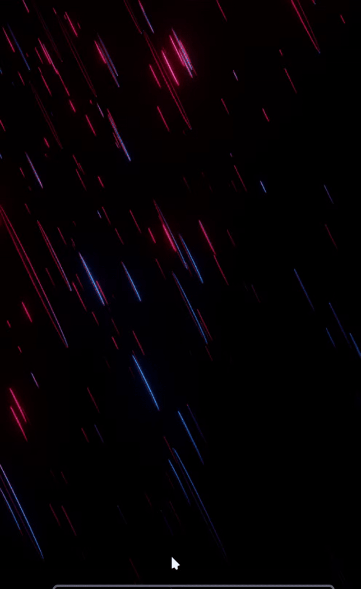

# CornerNote

CornerNote is a small GTK 3 quick-note overlay for KDE Plasma on Wayland. It
peeks from the top-right edge, keeps a draft in memory while it is collapsed,
and appends notes to Markdown files in an Obsidian vault.

CornerNote requires a Wayland compositor with the `wlr-layer-shell` protocol.
Fedora KDE Spin with Plasma provides the supported session. Fedora Workstation
uses GNOME Shell/Mutter, which does not expose layer-shell or allow applications
to place ordinary windows at exact screen coordinates under Wayland; this
project does not claim support for GNOME Workstation overlays.
 
[comment]: <> (For some reason it took me longer to get this working than any other feature here.)
## Requirements

- Fedora KDE Plasma running a Wayland session
- Python 3, PyGObject, GTK 3, Cairo, and gtk-layer-shell
- An Obsidian vault writable by your user

On Fedora, install the system packages with:

```sh
sudo dnf install python3 python3-gobject python3-cairo gtk-layer-shell
```

The overlay cannot run as a layer-shell surface on X11. Check with
`printf '%s\n' "$XDG_SESSION_TYPE"` and use a Wayland Plasma session.

KWin's `wlr-layer-shell` implementation has known quirks: overlay surfaces may
not suppress fullscreen windows on all Plasma versions, and behavior may differ
between Plasma 5.x and 6.x. Check the [KDE bug tracker query for
`wlr-layer-shell`](https://bugs.kde.org/buglist.cgi?quicksearch=wlr-layer-shell)
for the current status.

## Install

```sh
./install.sh
```

The installer checks dependencies, installs a user-level launcher and systemd
service, copies `config.example.json` to
`~/.config/cornernote/config.json` if no config exists, and enables the service
for the graphical session. Start it with `systemctl --user start cornernote`.
The service uses the current checkout, so keep this repository in place after
installing.

Remove the service and launchers with `./uninstall.sh`. This preserves your
settings by default; use `./uninstall.sh --purge-config` to delete them too.

Use `corner-note toggle` to open or close CornerNote. To bind a KDE global
shortcut, open **System Settings → Shortcuts → Add New → Command or URL** and
set the command to `corner-note toggle` with a shortcut such as Meta+N or F12.
This manual route works across Plasma versions.

## Use

- Hover the exposed paper tab to open it. Moving the pointer away collapses it.
- Press Meta+N (or your configured shortcut) to open and focus the note. The
  shortcut toggles the forced-open state.
- Enter in the title field moves focus to the note body.
- Submit normally to append a dated heading and draft to the configured
  quick-notes file. To append to another Markdown file, enter its path as the
  title or enable **Append mode**. A title ending in `.md` automatically
  selects append mode. Relative append paths resolve inside the configured
  vault; absolute `.md` paths are also accepted.
- Choose **No date** to omit the date from the saved heading. Typing `none` in
  the date field does the same. Custom dates such as `tomorrow` or `14.10` are
  still supported.
- Ctrl+Enter submits using the active mode.
- Ctrl+D toggles between a date and no date. Ctrl+Shift+D opens the date menu.
- Ctrl+Shift+A toggles append mode. Ctrl+Shift+F opens a Markdown-only picker
  to search for and append to an existing note in the vault.
- Ctrl+S toggles settings. The gear button also closes settings and returns to
  the editor. Settings collapse when the pointer leaves the overlay.
- In the note body, Ctrl+1 inserts a level-one heading, Ctrl+B wraps text in
  bold markers, Ctrl+I wraps text in italic markers, and Ctrl+U wraps text in
  an HTML underline tag.
- Escape opens an inline discard confirmation. Confirm with Y/Yes or cancel
  with N/No/Escape.
- The gear button toggles between the editor and settings for the vault,
  filename/date format, timing, tab peek, and appearance. Appearance changes
  are saved with **Apply style**; **Save settings** saves the other settings
  and returns to the editor.

Collapsing the overlay never clears a draft. A draft is cleared only after a
successful write or a confirmed discard. Write failures remain visible in the
overlay and preserve the text for retry.

## Configuration

Open the overlay and press the gear button for the in-app settings page, or
edit `${XDG_CONFIG_HOME:-~/.config}/cornernote/config.json` (normally
`~/.config/cornernote/config.json`). If `CORNERNOTE_CONFIG` is set, that file
is used instead. Settings are written atomically. The full template and
defaults are in [`config.example.json`](config.example.json). `note_filename` supports
`{date}` and `{title}` substitutions, for example `QuickNotes.md` or
`{date}.md`. Date tags accept `today`, `tomorrow`, weekday names, `in N days`,
and common numeric date forms. Position uses `position_horizontal` and
`position_vertical` (`left`/`center`/`right` and `top`/`center`/`bottom`);
`offset_x` and `offset_y` tune that reference point in pixels. Positive X
moves right and positive Y moves down. For top and bottom positions, the
outward Y offset is limited by the idle tab size so at least one pixel remains
visible when the note is collapsed. `monitor` selects `primary` or a
connected screen by its zero-based GDK display index; the settings page labels
each screen with its manufacturer, model, resolution, and desktop position,
truncating long labels with an ellipsis to keep the overlay width fixed.
The settings page also includes a folder chooser; under Plasma, GTK uses the
available KDE file chooser portal.

The default vault path is `~/Documents`. Change it in settings to the root of
your own Obsidian vault before saving notes.

Settings are grouped into display and position, vault and files, animation,
and appearance sections. Expand **Appearance and style** to open the embedded
editor. It previews the style and offers Plasma colors, Pywal colors, ten
built-in palettes, editable custom colors, installed font families and font
size, a local image backdrop, and rounded paper corners. The selected style is
saved to `config.json` and applied to the overlay. By default, colors follow
Plasma's `kdeglobals` palette, which CornerNote watches for changes. Text
contrast is corrected when a selected palette would make note text hard to
read. Settings also include independent note width and height controls. The
hide delay and slide duration are adjustable; defaults are 700 ms and 320 ms.

## Files

- `src/main.py` — GTK layer-shell overlay and daemon entry point
- `src/state.py` — draft buffer and note interaction state machine
- `src/style.py` — config, Pywal/KDE palette loading, and GTK CSS
- `src/style_editor.py` — standalone appearance editor and live preview
- `src/ipc.py` — GLib-integrated Unix socket server and CLI client
- `src/obsidian.py` — safe Markdown path selection and append writer
- `corner-note` — IPC command-line client
- `install.sh` — Fedora user installation
- `uninstall.sh` — removes user service and launchers, optionally config
- `packaging/bundle.py` — builds a distributable `CornerNote.zip`

## Development and troubleshooting

Run `python3 src/main.py` from the checkout to see errors in a terminal. In a
second terminal use `./corner-note toggle`. Inspect service logs with
`journalctl --user -u cornernote -f`. The socket defaults to
`$XDG_RUNTIME_DIR/cornernote.sock`, which is private to the login session.

Layer-shell overlay surfaces can cover panels and fullscreen windows by
design. Plasma may apply its own policy to overlay surfaces; the app does not
poll KWin state or promise fullscreen suppression.

CornerNote listens for systemd-logind sleep and wake notifications. On resume it
recreates the Wayland layer surface and reapplies the selected screen and
position, keeping the in-memory draft intact. If the system bus is unavailable,
the overlay continues to run normally but cannot perform this resume recovery.

## Roadmap / Known Limitations

GTK 3 is in maintenance mode. A port to GTK 4 or Qt is a long-term consideration.

## Known Issues

**Overlay disappears after suspend/resume**
On some systems the layer-shell surface is not automatically recreated after
waking from suspend. The service continues running normally but the overlay
is no longer visible. Workaround until this is resolved:

```bash
    systemctl --user restart cornernote
```

This is a Wayland compositor surface lifecycle issue and may affect other
layer-shell applications on the same setup. Multi-monitor and hybrid GPU
configurations appear more likely to trigger it.

